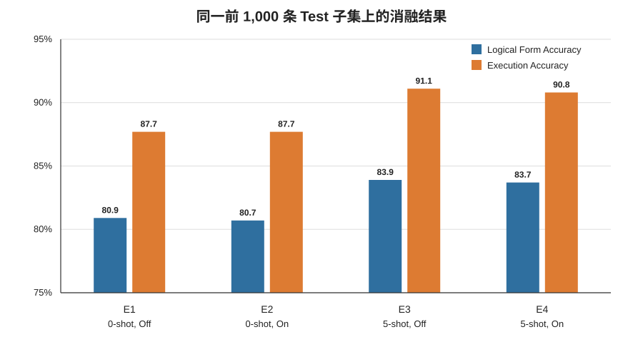
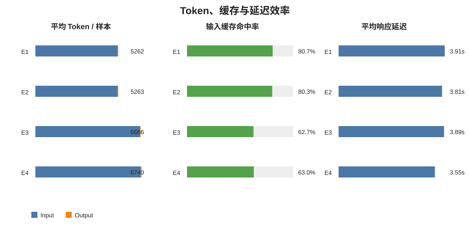

# GPT-5.6-sol 在 WikiSQL 上的 Text-to-SQL 基线

**实验日期：** 2026 年 11 月 18 日  
**数据集：** WikiSQL  
**主模型：** gpt-5.6-sol（Responses API）  
**报告类型：** Test 集正式实验结果 + 人工语义评测 pilot  
**报告版本：** v3（汇入 20 条人工语义标注）

---

## 摘要

本文系统评估大语言模型 gpt-5.6-sol 在 WikiSQL 单表 Text-to-SQL 任务上的零样本与少样本基线。主系统 E4 采用 Schema-aware 提示词、基于 Train 集的动态 5-shot 检索、无损表格序列化和 high reasoning effort，在完整 Test 集 15,878 条样本上取得 **85.63% Logical Form Accuracy（LFA）** 与 **90.77% Execution Accuracy（EX）**，95% Wilson 置信区间分别为 [85.07%, 86.16%] 与 [90.31%, 91.21%]。全部预测通过 JSON 与结构化 SQL 校验，执行成功率为 99.94%。

在同一前 1,000 条 Test 子集上的成对消融显示：动态 5-shot 检索相对 0-shot 提升 3.00 个百分点 LFA 与 3.40 个百分点 EX（McNemar 精确检验 p < 0.001）；单独开启 high reasoning effort 未带来可观测收益（E1 vs E2：p = 0.8145；E3 vs E4：p = 0.8145）。

在 Test 前 20 条 pilot 上进行的单标注人工语义评测中，20/20 被判为语义正确（95% CI [83.89%, 100%]）；同一子集的自动 LFA/EX 均为 90%，两条自动判错样本分别源于金标错误与问题歧义。该 pilot 仅用于暴露评价口径问题，不作为总体 Semantic Accuracy。

分层分析表明，系统在聚合查询、非等值条件、数值条件和宽表上明显退化：SUM 的 LFA 仅 44.12%，COUNT 为 59.18%；含 `>`/`<` 条件的样本 LFA 为 72.10%，而全部为等值条件时为 88.69%；含数值条件的样本 LFA 为 78.76%，字符串条件为 86.52%。此外，本文对数据规模、表长尾分布、提示词冻结、采样参数与成本口径进行了审计，发现现有实验在 Test 集复用、Dev 验证规模、提示词冻结证据链和缓存成本归因方面存在不足。本文认为该结果可作为可复核的工程基线，但尚不足以支撑“已完成系统性 Prompt 调优”或“SOTA”类结论。

**关键词：** Text-to-SQL；WikiSQL；大语言模型；少样本检索；执行准确率；实验审计

---

## 1 引言

WikiSQL 是单表自然语言到 SQL 的代表性基准，其目标是在给定一张表和一句自然语言问题的条件下，生成 `SELECT` 列、聚合函数与 `WHERE` 条件组成的逻辑形式。与 Spider 等多表跨库任务相比，WikiSQL 的 SQL 空间受限，但由于真实表格存在列名歧义、取值多样、表规模长尾等问题，仍然是检验 schema linking、条件值匹配和聚合识别的重要基线。

本文关注的问题是：在不微调云端模型的前提下，仅依靠提示词、动态示例检索与结构化输出约束，当前大语言模型能在 WikiSQL 上达到什么水平；这些增益来自哪个组件；以及现有实验记录是否足以支撑相应结论。

本文的贡献如下：

1. 在完整 Test 集（15,878 条）上给出 gpt-5.6-sol 的可复核基线结果，并报告置信区间。
2. 在同一 1,000 条子集上完成 2×2 成对消融（0/5-shot × thinking off/on），并给出精确 McNemar 检验。
3. 补充按聚合类型、条件数量、检索分数、表行数、列数、算子类型和值类型的多维分层分析。
4. 从数据集、实验设计、算法与可复现性四个层面审计现有实验，明确指出结论的适用边界。

---

## 2 WikiSQL 数据集介绍与统计分析

### 2.1 数据集概览

WikiSQL 由 Wikipedia 表格及人工标注的问题-SQL 对组成（Zhong et al., 2017；官方数据、评测脚本与说明见 https://github.com/salesforce/WikiSQL 。每条样本包含：

- 一张表：列名（header）、列类型（text / real）、若干行单元格；
- 一个自然语言问题；
- 一个逻辑形式：选择列 `sel`、聚合算子 `agg`、条件列表 `conds`，每个条件为 `[列索引, 算子, 值]`。

本地数据快照包含 Train / Dev / Test 三个划分，示例数分别为 56,355 / 8,421 / 15,878，合计 80,654 条。表文件共 26,531 张表（Train 18,585、Dev 2,716、Test 5,230），其中被问题引用的表分别为 17,984 / 2,630 / 5,069；其余为未被引用的表。三个划分的表 ID **完全互不重叠**（交集均为 0），这避免了跨划分的表级泄漏。

> 说明：公开文献对 WikiSQL 表数量的统计口径存在差异。本报告以本地数据文件为准。

**表 1 数据划分与表级统计**

| 划分 | 示例数 | 表文件数 | 被引用表数 | 平均行数/表 | 行数中位数 | 行数 P95 | 最大行数 | >100 行的表 | 平均列数 | 最大列数 |
|---|---:|---:|---:|---:|---:|---:|---:|---:|---:|---:|
| Train | 56,355 | 18,585 | 17,984 | 17.1 | 11 | 44 | 1,956 | 195 | 6.35 | 44 |
| Dev | 8,421 | 2,716 | 2,630 | 16.5 | 11 | 43 | 433 | 27 | 6.31 | 20 |
| Test | 15,878 | 5,230 | 5,069 | 18.4 | 12 | 48 | 1,950 | 75 | 6.32 | 23 |

Test 集问题长度平均 11.7 个词，P95 为 20 个词，最大 43 个词；每个表平均被 3.04 个问题引用，最多 6 个。Test 集包含 15,832 个不同问题字符串，即存在 46 个重复问题。

### 2.2 Test 集 SQL 结构分布

**表 2 Test 集 SQL 结构分布（N = 15,878）**

| 维度 | 类别 | 数量 | 占比 |
|---|---|---:|---:|
| 聚合 | NONE | 11,324 | 71.32% |
| 聚合 | MAX | 973 | 6.13% |
| 聚合 | MIN | 933 | 5.88% |
| 聚合 | COUNT | 1,455 | 9.16% |
| 聚合 | SUM | 587 | 3.70% |
| 聚合 | AVG | 606 | 3.82% |
| 条件数 | 0 | 131 | 0.83% |
| 条件数 | 1 | 10,832 | 68.22% |
| 条件数 | 2 | 3,879 | 24.43% |
| 条件数 | 3+ | 1,036 | 6.52% |
| 条件算子 | `=` | 18,114 | 82.96% |
| 条件算子 | `>` | 1,927 | 8.82% |
| 条件算子 | `<` | 1,805 | 8.27% |
| 条件值 | 字符串 | 16,424 | 75.19% |
| 条件值 | 数值 | 5,422 | 24.81% |

可以看到三个显著的不均衡：

1. **聚合不均衡**：71.32% 的查询不带聚合，而 COUNT/SUM/AVG 合计仅 16.68%。微平均 LFA 会被 NONE 类主导。
2. **条件数集中**：68.22% 的查询只有 1 个条件，2 个及以上条件占 30.96%。
3. **算子与值类型偏斜**：等值条件占 82.96%，字符串值占 75.19%；`>`/`<` 与数值条件属于少数但更难的分支。

### 2.3 表规模长尾与上下文成本

Test 集表行数呈明显长尾：75 张表超过 100 行（1.43%），3 张超过 500 行，3 张超过 1,000 行，最大 1,950 行。由于 E4 采用“保留全部行”的无损表格序列化，长表会直接转化为输入 token：

- E4 平均输入 6,694 tokens/样本，P95 为 8,928，P99 为 12,739，最大 **132,634** tokens；
- 输入超过 10k tokens 的样本 492 条（3.10%），超过 20k 的 30 条（0.19%），超过 30k 的 19 条（0.12%）。

这意味着长表虽然比例低，但决定了上下文窗口、延迟和成本的上界，是该方法最脆弱的运行边界之一。

### 2.4 数据集层面的任务特征

- **单表、有限 SQL 语法**：不支持 JOIN、子查询、GROUP BY、HAVING、ORDER BY、多列聚合等，因此结果不能直接外推到 Spider 等复杂场景。
- **模式简单但取值开放**：列名往往来自 Wikipedia 表头，存在缩写、同义与大小写差异；条件值可能带单位、百分号、日期或数字。
- **存在逻辑形式等价**：不同 SQL 可能在当前表上得到相同结果，导致 EX 高于 LFA（本文 E4 相差 5.15 个百分点）。
- **金标不含 `OP=3`**：本地 Train/Dev/Test 金标条件算子只有 `=`、`>`、`<`；但提示词允许模型输出算子 3，造成结构合法但执行器不支持的情况（E4 共 10 条）。

---

## 3 基线算法与实验策略

### 3.1 总体框架

```
问题 q + 目标表 T
        │
        ├── 动态 5-shot 检索（仅从 Train 表/问题/SQL 中检索）
        │        └── 词法相似度 + SQL 结构启发式 + 表头重合度
        │
        ├── Prompt 构造
        │        ├── Schema-aware developer 指令
        │        ├── few-shot 示例（问题 + 紧凑表 + 金标 SQL）
        │        └── 目标问题 + 无损紧凑表
        │
        ├── Responses API（strict JSON Schema）
        │        └── {sel, agg, conds}
        │
        └── 逻辑形式校验 → SQLite 执行 → LFA / EX
```

实现位于 `experiment/run_modern_baseline.py`

### 3.2 模型与推理参数

| 项目 | 取值 |
|---|---|
| 模型 | `gpt-5.6-sol` |
| 接口 | Responses API，`/v1/responses` |
| 输出约束 | `text.format = json_schema`，`strict = true` |
| 输出上限（代码设定） | 256 tokens（E1/E3）、384 tokens（E2/E4）；不完整时回退 768 |
| reasoning effort | E1/E3 为 `none`，E2/E4 为 `high` |
| 采样参数 | 未在代码中设置；原始响应显示服务端默认 `temperature=1.0`、`top_p=0.98` |
| 微调 | 无 |

需要指出：实际记录中输出 tokens 最大值达到 1,117（E4），说明网关并未严格执行代码设定的 `max_output_tokens`；该约束与“不完整回退”逻辑在本轮实验中未真正发挥作用。

### 3.3 Prompt 设计

developer prompt 采用固定 Schema-aware 指令，要求模型：

1. 只输出 `sel`、`agg`、`conds`；
2. 列索引从 0 开始；
3. 聚合算子取 0–5；
4. 条件为 `[列索引, 整数算子, 值]`，不允许输出符号算子；
5. 只依据问题与表格作答；
6. 保留条件中的原始取值；
7. 不输出解释。

user prompt 由“问题 + 紧凑表格 JSON”组成，表格包含列名、列类型与全部行。输出由 strict JSON Schema 约束，避免自由文本解析。

>注：**Dev 验证不构成“调优”证据**：四个 Prompt 版本各只跑 2 条/组，且全部满分。更准确的表述是“Prompt 预先设计，Dev 仅做流程冒烟验证”。

### 3.4 动态少样本检索

检索器仅使用 Train 集，评分由三部分构成：

- 问题与示例问题的词法相似度（IDF 加权、问题结构启发式）；
- 目标表表头与示例表表头的重合度；
- SQL 结构启发式（聚合、条件数量等）。

候选集先按词法重叠剪枝，再排序取 Top-5。每个示例的表被投射到其 SQL 使用到的列，但保留**全部行**；示例 SQL 使用 Train 金标。Test 金标不进入提示词。

### 3.5 实验条件

**表 3 四组实验设计**

| 实验 | Few-shot | Thinking | 推理强度 | Test 样本数 | 角色 |
|---|---:|---|---|---:|---|
| E1 | 0-shot | Off | none | 1,000 | 基础对照 |
| E2 | 0-shot | On | high | 1,000 | Thinking 消融 |
| E3 | 5-shot | Off | none | 1,000 | Few-shot 消融 |
| E4 | 5-shot | On | high | 15,878 | 主基线 |

E1–E3 为节省成本只使用 Test 前 1,000 条（非随机抽样）；E4 覆盖完整 Test。为公平比较，本文同时报告 E4 在同一前 1,000 条上的结果。**消融样本量小**：1,000 条子集足以做配对检验，但不能代表全 Test 分布

### 3.6 评测指标

| 指标 | 定义 |
|---|---|
| LFA（Logical Form Accuracy） | `sel` 与 `agg` 完全一致；`conds` 按无序集合比较，值转为小写 |
| EX（Execution Accuracy） | 预测 SQL 与金标 SQL 在对应 SQLite 库上执行，结果列表完全相等 |
| SQL Validity | 结构校验通过（列索引、聚合、算子、值类型均在合法范围） |
| Execution Success Rate | 结构有效的预测中，可在 SQLite 中成功执行的比例 |
| JSON Validity | 能解析为合法 JSON 对象的比例 |
| Semantic Accuracy（pilot） | 人工判断预测是否与问题意图一致；`1` 正确、`0` 错误、`?` 歧义。本报告仅报告 20 条 pilot，单人标注，未计算 κ |

EX 使用列表严格相等，而非集合比较；对于多行、无序结果，理论上可能与官方口径产生差异。

---

## 4 实验结果

### 4.1 完整运行结果

**表 4 四组实验汇总**

| 实验 | N | LFA (%) | EX (%) | JSON Validity (%) | SQL Validity (%) | Execution Success (%) |
|---|---:|---:|---:|---:|---:|---:|
| E1 | 1,000 | 80.90 | 87.70 | 100.00 | 100.00 | 99.80 |
| E2 | 1,000 | 80.70 | 87.70 | 100.00 | 100.00 | 99.90 |
| E3 | 1,000 | 83.90 | 91.10 | 100.00 | 100.00 | 100.00 |
| **E4** | **15,878** | **85.63** | **90.77** | **100.00** | **100.00** | **99.94** |

E4 的 95% Wilson 置信区间：LFA [85.07%, 86.16%]，EX [90.31%, 91.21%]。E4 共 13,596 条 LFA 正确、14,413 条 EX 正确；10 条因算子 `OP=3` 不可执行。

> 注：E1–E3 与 E4 的样本规模不同，表 4 用于汇总运行结果；严格消融结论应以表 5 的同一 1,000 条子集为准。
> 值得注意的是：E4 在同子集上并不优于 E3，thinking 也无增益；“E4 为主基线”是预设，而非消融选优。

### 4.2 同子集消融

**表 5 相同前 1,000 条 Test 子集上的公平比较**

| 实验 | LFA (%) | EX (%) | ΔLFA vs E1 (pp) | ΔEX vs E1 (pp) |
|---|---:|---:|---:|---:|
| E1 | 80.90 | 87.70 | +0.00 | +0.00 |
| E2 | 80.70 | 87.70 | -0.20 | +0.00 |
| E3 | 83.90 | 91.10 | +3.00 | +3.40 |
| E4 | 83.70 | 90.80 | +2.80 | +3.10 |



*图 1：0/5-shot 与 thinking 开关的成对消融。误差线为 95% Wilson 置信区间。*

### 4.3 成对显著性检验

**表 6 双侧精确 McNemar 检验**

| 对比 | 指标 | 左对右错 | 左错右对 | p-value |
|---|---|---:|---:|---:|
| E1 vs E2 | LFA | 10 | 8 | 0.8145 |
| E1 vs E2 | EX | 8 | 8 | 1.0000 |
| E1 vs E3 | LFA | 13 | 43 | 7.333e-05 |
| E1 vs E3 | EX | 12 | 46 | 8.220e-06 |
| E3 vs E4 | LFA | 10 | 8 | 0.8145 |
| E3 vs E4 | EX | 9 | 6 | 0.6072 |

结论：5-shot 相对 0-shot 的增益在 LFA 与 EX 上均显著；thinking off/on 在任何一组对比中均不显著。

### 4.4 分层结果

**表 7 E4 按聚合类型分层**

| 聚合 | N | LFA (%) | EX (%) |
|---|---:|---:|---:|
| NONE | 11,324 | 95.10 | 96.35 |
| MAX | 973 | 68.55 | 88.18 |
| MIN | 933 | 70.53 | 89.82 |
| COUNT | 1,455 | 59.18 | 68.25 |
| SUM | 587 | 44.12 | 59.63 |
| AVG | 606 | 63.04 | 76.40 |

按聚合类型宏平均，LFA 为 **66.75%**，EX 为 **79.77%**，显著低于微平均的 85.63% / 90.77%。这说明整体成绩主要由无聚合查询贡献。

**表 8 E4 按 WHERE 条件数量分层**

| 条件数量 | N | LFA (%) | EX (%) |
|---|---:|---:|---:|
| 0 | 131 | 91.60 | 93.13 |
| 1 | 10,832 | 87.68 | 92.79 |
| 2+ | 4,915 | 80.94 | 86.27 |

**表 9 E4 按表规模、列数、算子与值类型分层（本文新增）**

| 维度 | 分组 | N | LFA (%) | EX (%) |
|---|---|---:|---:|---:|
| 表行数 | 1–10 | 7,251 | 85.57 | 90.46 |
| 表行数 | 11–30 | 7,005 | 85.54 | 90.81 |
| 表行数 | 31–100 | 1,388 | 86.24 | 91.93 |
| 表行数 | >100 | 234 | 86.32 | 92.74 |
| 条件算子 | 含 `>` 或 `<` | 2,928 | 72.10 | 78.52 |
| 条件算子 | 全部为 `=` | 12,950 | 88.69 | 93.54 |
| 条件值 | 含数值条件 | 4,073 | 78.76 | 83.75 |
| 条件值 | 含字符串条件 | 13,536 | 86.52 | 91.64 |
| 列数 | 5–6 列 | 10,292 | 86.05 | 91.06 |
| 列数 | 7–9 列 | 4,799 | 85.52 | 90.87 |
| 列数 | ≥10 列 | 787 | 80.81 | 86.40 |

表规模并未导致准确率下降，长表组（>100 行）甚至略高；该组仅 234 条，且长表主要集中在少数表上，不足以得出“长表鲁棒”的结论。真正的成本体现在输入 token 的尾部（最大 132,634）。

### 4.5 错误分析

**表 10 E4 逻辑形式与执行结果交叉表**

| 类型 | 数量 | 比例 (%) | 解释 |
|---|---:|---:|---|
| LF 正确 / EX 正确 | 13,596 | 85.63 | 逻辑形式与执行结果均正确 |
| LF 错误 / EX 正确 | 817 | 5.15 | 非金标逻辑形式，但在当前表上得到相同答案 |
| LF 正确 / EX 错误 | 0 | 0.00 | 逻辑匹配但执行差异；本轮未出现 |
| LF 错误 / EX 错误 | 1,465 | 9.23 | 真实预测错误 |

另有 10 条结构合法但不可执行的预测，全部由 `OP=3` 导致（0.06%）。错误高度集中在聚合、非等值条件、数值条件与宽表四类。

**表 11 检索 Top-1 分数四分位与性能**

| 四分位 | 分数范围 | N | LFA (%) | EX (%) |
|---|---|---:|---:|---:|
| Q1 | 0.239–0.671 | 3,969 | 83.04 | 89.42 |
| Q2 | 0.671–0.776 | 3,970 | 83.35 | 89.29 |
| Q3 | 0.776–0.859 | 3,969 | 86.80 | 91.91 |
| Q4 | 0.859–1.000 | 3,970 | 89.32 | 92.47 |

检索分数与准确率呈正相关（Q1 → Q4：LFA +6.28 pp，EX +3.05 pp），但这是相关性而非因果证据；高相似度样本本身可能也更简单。

### 4.6 效率、缓存与成本



*图 2：各组输入/输出 token、缓存命中率与延迟分布。*

### 4.7 人工语义评测（pilot）

为检查自动指标是否与真实语义一致，本文对 E4 在 Test 前 20 条上的预测进行了单标注人工评测。评测样本、表格、预测/金标 SQL 及执行结果见 `reports/modern_baseline/human_eval/E4_semantic_worksheet.md`，标注记录见 `E4_semantic_labels.csv`。判定标准为：`1` 表示与问题意图一致且答案等价；`0` 表示语义错误；`?` 表示问题歧义或表格信息不足。

**表 12 E4 人工语义评测结果（20 条 pilot）**

| 指标                |                 结果 |
| ----------------- | -----------------: |
| 标注样本              |                 20 |
| 标签 1 / 0 / ?      |         20 / 0 / 0 |
| Semantic Accuracy |    **100%（20/20）** |
| Wilson 95% CI     | **[83.89%, 100%]** |
| 同 20 条自动 LFA      |      90.00%（18/20） |
| 同 20 条自动 EX       |      90.00%（18/20） |
| 标注者数量             |                  1 |
| Cohen's κ         |               无法计算 |

人工标签与自动指标完全一致的有 18 条；其余 2 条人工判为语义正确、自动 LFA/EX 判错。没有出现“人工判错、自动判对”的样本。

**金标错误案例**（`test:5:1-10083598-1`）：问题为 “What was the number of race that Kevin Curtain won?”。表中 Kevin Curtain 在第 1 行是 Pole Position（杆位），Race winner（分站冠军）为 Kenan Sofuoğlu。预测按 `Race winner = Kevin Curtain` 计数得 0，金标按 `Pole Position = Kevin Curtain` 计数得 1。问“赢了几场”时 0 才是正确答案，故该条为金标标注错误，而非模型错误。

**问题歧义案例**（`test:19:1-1015521-2`）：问题为 “Give me a list of all spanish officer titles that could receive recognition as group captain in english”。预测选择 Rank in Spanish（`coronel`），金标选择 Rank in English（`colonel`）；两种解释均成立，按本工作单规范应标 `?` 或在备注中记录所选解释。当前标注为 1，因此 100% 略偏乐观。

**“实例正确、程序层不可泛化”案例**：S07、S09、S10 都问“有多少个不同的 X”，但预测与金标均使用 `COUNT(列)` 而非 `COUNT(DISTINCT)`；由于过滤后恰好只有 1 行，结果正确。这类样本不能说明模型掌握了去重计数语义。

因此，20/20 只能作为 **pilot 信号**：它说明自动 EX 会低估语义正确的预测（至少 1 例金标错误），但不能作为 E4 在总体上的 Semantic Accuracy；样本为 Test 前 20 条、仅覆盖 6 张表、单人标注且无 κ，尚不具备统计代表性。

---

## 5 讨论

### 5.1 5-shot 检索是主要增益来源

同子集上 E3 相对 E1 的 LFA/EX 提升为 +3.00/+3.40 pp，且 McNemar p 值均小于 0.001；E3 的执行成功率为 100%，优于 E1 的 99.80%。示例帮助模型识别聚合形式、选择列和条件边界，这一点与分层结果一致：5-shot 后 COUNT/SUM 等聚合类错误有所缓解（尽管仍是最弱分支）。

### 5.2 Thinking High 未表现出独立收益

E2 与 E1 的 EX 完全相同，LFA 低 0.20 pp；E4 相对 E3 的差异为 -0.20/-0.30 pp，且不显著。请求中确实记录了 `reasoning.effort=high`，但 usage 中的 reasoning tokens 并不随配置单调变化（E1 为 4,455，E2 为 5,738，E3 为 6,491，E4 子集为 5,762）。该字段不适合作为推理强度的独立证据，端到端正确率也未显示收益。

### 5.3 EX 高于 LFA 的含义

E4 的 EX 比 LFA 高 5.15 pp，主要来自 817 条“LF 错误 / EX 正确”的等价查询。这些查询虽然条件或选择列与金标不同，但在当前表上返回相同结果。该现象说明：

- 仅报告 EX 会高估结构生成能力；
- 仅报告 LFA 会低估实际可用性；
- 两者应同时报告，并单独分析 denotation equivalence。

### 5.4 聚合、非等值条件、数值条件是主要短板

- SUM 的 LFA 仅 44.12%，COUNT 为 59.18%，AVG 为 63.04%；
- 含 `>`/`<` 的样本 LFA 为 72.10%，比全等值条件低 16.59 pp；
- 含数值条件的样本 LFA 为 78.76%，比字符串条件低 7.76 pp；
- ≥10 列的宽表 LFA 为 80.81%，比 5–6 列低 5.24 pp。

这些分支的共同点是需要更精确的列语义匹配与取值规范化，而当前方法主要依赖词法检索和模板化提示词，缺少 schema/value linking 与执行反馈。

### 5.5 长表的“准确率不降、成本激增”

按行数分层，>100 行的表准确率并未下降，但输入 token 尾部极大（P99 12,739，最大 132,634）。这说明模型在本次样本上尚能处理长表，但方法对上下文预算的依赖很强：一旦换用上下文更小的模型，或表行数进一步增长，尾部样本会首先失败。

### 5.6 人工语义评测揭示的金标噪声与偶然正确

20 条 pilot 的语义准确率为 100%，而同一子集的自动 LFA/EX 为 90%。差异并非来自模型“多答对了两条”，而是来自评价口径：

- **金标噪声**：S06 的问句要求统计胜场，金标却按杆位列计数，预测给出的 0 才是正确答案；
- **问题歧义**：S20 的 “spanish officer titles ... in english” 可指西班牙语职称或英文对应职称，人工标注选择了前者；
- **偶然正确**：S07/S09/S10 的 COUNT 查询依赖“过滤后只有一行”，并非真正的 DISTINCT 计数，换表即可能失效。

这三点共同说明：LFA/EX 不是语义真值，单靠自动指标既可能低估语义正确性，也可能高估程序泛化能力。正式论文应同时报告自动指标、人工语义评测与金标噪声分析；在扩样与双人标注完成前，不应把 20/20 写成总体 Semantic Accuracy。

---

## 6 实验问题

### 6.1 数据集问题

#### 6.1.1 SQL 结构高度偏斜

| 维度 | 分布 |
|---|---|
| 聚合 | 无聚合 71.32%，COUNT 9.16%，MAX 6.13%，MIN 5.88%，AVG 3.82%，SUM 3.70% |
| 条件数 | 单条件 68.22%，双条件 24.43%，三条件及以上 6.52%，无条件 0.83% |
| 条件算子 | `=` 82.96%，`>` 8.82%，`<` 8.27% |
| 条件值类型 | 字符串 75.19%，数值 24.81% |

这种分布会使系统更容易依赖简单等值查询，训练出的模型通用性不强，也难以用该基准充分验证模型的通用性。

#### 6.1.2 SQL 语法覆盖过窄

WikiSQL 的逻辑形式只支持：

- 单表；
- 单列 `SELECT`；
- 6 种聚合（NONE / MAX / MIN / COUNT / SUM / AVG）；
- 条件之间只有 AND；
- 每个条件只有 `=`、`>`、`<`；
- 每个条件只有一个值。

它不能表达：JOIN、子查询、GROUP BY、HAVING、ORDER BY、LIMIT、DISTINCT、UNION、OR、IN、BETWEEN、LIKE、IS NULL、NOT、算术运算、多列聚合、日期函数、top-k、比例/差值计算。

这导致大量自然语言问句只能被“压扁”成受限形式。对 Test 问句做粗略词面统计：

| 语言现象 | 问句数（粗略） | WikiSQL 可表达性 |
|---|---:|---|
| 否定词（not / except / without） | 27 | 无 NOT；常被当成单元格值 |
| or | 73 | 无 OR；通常退化为单条件 |
| between | 7 | 无 BETWEEN；常退化为等值 |
| contains / starts with / ends with | 6 | 无 LIKE；只能等值 |
| top / first / last / highest / lowest / most / least | 1,516 | 部分可由 MAX/MIN 表达，top-k 与排序无法表达 |
| before / after / since / until | 326 | 只有字符串等值与 `>`/`<`，无日期语义 |
| difference / ratio / percentage / times | 154 | 无算术；只能选择已有百分比列 |

因此，在 WikiSQL 上成功不等于能处理真实业务问题；它更像“表格单元格检索 + 聚合模板匹配”。

#### 6.1.3 金标错误与问题歧义

在 20 条人工语义评测样本中发现 2 例问题，其中 1 例为金标错误、1 例为问题歧义：

- **金标错误**：`test:5:1-10083598-1` 问 “What was the number of race that Kevin Curtain won?”。表中 Kevin Curtain 是 Pole Position（杆位），不是 Race winner；金标却按杆位计数得 1，而正确答案是 0。这说明至少部分金标不可靠，不能把 LFA/EX 直接当作语义真值。
- **问题歧义**：`test:19:1-1015521-2` 问 “all spanish officer titles ... in english”，既可理解为输出西班牙语职称（`coronel`），也可理解为输出英文对应职称（`colonel`）；金标只选一种解释，且没有歧义标记。

#### 6.1.4 标注噪声与值规范化

18,114 个等值条件中，有 28 个（0.15%）即使忽略大小写也找不到完全匹配的单元格。典型问题包括：

- 逗号/空格不一致：`Indonesia , Denpasar` vs `indonesia, denpasar`；
- 复合值：`Channing Frye , Jason Richardson (8)` vs `Channing Frye, Jason Richardson (8)`；
- 值根本不在表中，或需要跨列/跨行推断。

这一比例不高，但说明“字符串等值匹配”并不总是可靠。

#### 6.1.5 语言质量参差

问题中存在拼写错误、大小写不一致、缺失标点，例如 “What clu was in toronto 1995-96”“conceeded”“Nejhl” vs “NEJHL”。标注者仍需给出唯一 SQL，解释空间较大。

#### 6.1.6 列名过于通用

Test 中最常见表头及出现次数如下：

| 表头 | 出现次数 |
|---|---:|
| `date` | 1,450 |
| `score` | 881 |
| `opponent` | 582 |
| `record` | 576 |
| `result` | 524 |
| `player` | 497 |
| `year` | 487 |
| `venue` | 441 |
| `position` | 433 |
| `team` | 432 |

这些列名本身歧义很大，且数据没有列描述、单位说明或业务语义。

#### 6.1.7 每表覆盖薄与表规模长尾

- **每表问题太少**：Test 共 5,069 张被引用表、15,878 条问题，平均每表约 3.1 条，最多 6 条；单表覆盖很薄，难以支撑表内组合泛化。
- **表规模长尾**：最大 1,950 行；75 张表超过 100 行（1.43%），3 张超过 500 行，3 张超过 1,000 行。长表比例低，但决定了上下文与成本上界；E4 的最大输入达到 132,634 tokens。

#### 6.1.8 答案与语言的双重单一化

**微平均掩盖聚合短板。** E4 的微平均 LFA 为 85.63%，但按聚合类型宏平均只有 66.75%；SUM 仅 44.12%，COUNT 59.18%。这说明模型在真正的聚合推理上远弱于总体数字。

**答案高度单一。** 金标执行结果的行数分布如下：

| 金标执行结果行数 | 数量 | 占比 |
|---|---:|---:|
| 1 行 | 15,425 | 97.15% |
| 2–5 行 | 366 | 2.31% |
| 6–20 行 | 77 | 0.49% |
| 超过 20 行 | 10 | 0.06% |
| 空结果 | 0 | 0% |

也就是说，97% 的查询只要求返回一个值。这让 EX 很容易饱和：只要选对列、过滤到那一行，结果就正确。

**条件选择性极高。**

- 13,638 个等值条件只匹配 1 行；
- 3,107 个匹配 2–5 行；
- 1,159 个匹配 6–20 行；
- 182 个匹配超过 20 行；
- 28 个匹配 0 行；
- 11,632 条问题（73.26%）的所有等值条件唯一确定一行。

因此，WikiSQL 主要测的是“单行定位”，而不是多行推理、连接、分组或复杂条件组合。

**语言高度模板化。**

- “what is the” 开头 4,320 条（27.2%）；
- “what was the” 1,146 条（7.2%）；
- 前 15 个三词前缀覆盖 43.2% 的 Test 问句；
- Test 中有 28 条问题与 Train 完全相同（表不同），Train–Dev 有 21 条、Dev–Test 有 6 条完全相同。

模型可以利用这些表面模式、列位置和常见问法，而不真正理解 schema。

### 6.2 可复现与审计问题

1. **Prompt 不可复原**：`prompt_freeze.json` 只含版本号、哈希与配置，不含 system/user 正文；`responses.jsonl` 也不保存实际 Prompt。哈希输入不包括 Prompt 文本、检索权重、示例序列化格式与代码版本。
2. **版本号不可靠**：`v2-cache-compact` 与 `_v2` 使用同一版本号但哈希不同，版本号未随修改递增。
3. **人工语义评测规模不足**：目前仅有 Test 前 20 条、单人标注，未计算 Cohen's κ，不能代表总体；`semantic_samples.jsonl` 的 `manual_label` 仍为 null，标签只存在于 CSV。
4. **Semantic Accuracy 未进入自动汇总**：`metrics.json` 的 `semantic_accuracy` 仍为 null，实验代码没有读取标注文件的 scorer。
5. **样本选择偏差**：20 条为 Test 前 20 条，非随机/分层，且以简单等值查询为主，语义准确率被高估。

---

## 7 结论

本文在完整 WikiSQL Test 集上复核了 gpt-5.6-sol 的 5-shot 基线：**85.63% LFA、90.77% EX**，格式合法性 100%，执行成功率 99.94%。同子集消融表明动态 5-shot 检索是主要增益来源（+3.00 pp LFA / +3.40 pp EX，p < 0.001），而 high reasoning effort 未产生可观测收益。

同时，分层结果揭示了明确的短板：SUM/COUNT 等聚合查询、`>`/`<` 非等值条件、数值条件与宽表上的准确率显著低于总体；按聚合宏平均的 LFA 仅 66.75%。现有实验在 Dev 验证规模、Test 集复用、提示词冻结证据链、采样参数与成本归因方面存在不足，因此本文将其定位为**可复核的工程基线**，而非“已完成系统性调优”的最终系统。后续工作应优先补足冻结与复现证据链，再引入更强的检索、schema/value linking 与执行反馈。

人工语义评测 pilot 进一步表明：20/20 的语义正确率与自动 EX 90% 的差异主要来自 1 条金标错误和 1 条问题歧义，而非模型能力差异；该结果只能作为评价口径的警示，不能替代扩样后的正式语义评测。

---

## 附录 A 数据与代码索引

| 内容                  | 路径                                                   |
| ------------------- | ---------------------------------------------------- |
| 实验代码                | `experiment/run_modern_baseline.py`                  |
| 基础模块（数据/API/执行器/指标） | `experiment/run_experiment.py`                       |
| 正式结果                | `results/formal_test/test/E1`–`E4`                   |
| 主指标                 | `results/formal_test/test/E4/metrics.json`           |
| 逐样本评测               | `results/formal_test/test/E4/evaluated.jsonl`        |
| 原始响应                | `results/formal_test/test/E4/responses.jsonl`        |
| 错误用例                | `results/formal_test/test/E4/error_cases.md`         |
| 人工评测工作单             | `reports/modern_baseline/human_eval/E4_semantic_worksheet.md` |
| 人工标注记录              | `reports/modern_baseline/human_eval/E4_semantic_labels.csv` |
| 提示词冻结               | `results/formal_test/prompt_freeze.json`             |
| 本报告                 | `reports/modern_baseline/WikiSQL__Baseline__Report.md` |

## 附录 B 指标与统计口径

- **LFA**：`sel`、`agg` 严格相等；`conds` 按无序集合比较，值统一小写。重复条件会被集合比较吞掉（金标中罕见）。
- **EX**：预测 SQL 与金标 SQL 分别在对应 SQLite 库执行，结果列表严格相等。空结果 `[]` 视为可执行。
- **SQL Validity**：结构校验通过；不保证可执行。
- **Execution Success Rate**：结构有效且可执行的样本比例。
- **Semantic Accuracy**：人工判断预测是否与问题意图一致；`1` 正确、`0` 错误、`?` 歧义（不计入分母）。当前仅有 20 条 pilot。
- **置信区间**：Wilson 区间，95% 水平。
- **McNemar**：双侧精确二项检验，仅使用不一致对。
- **宏平均**：对聚合类型六类等权平均，用于抵消 NONE 类的样本量优势。
