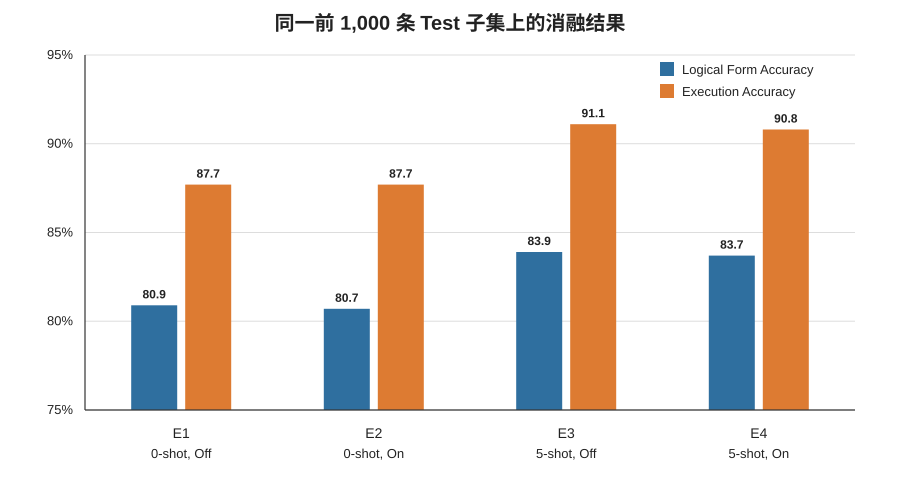
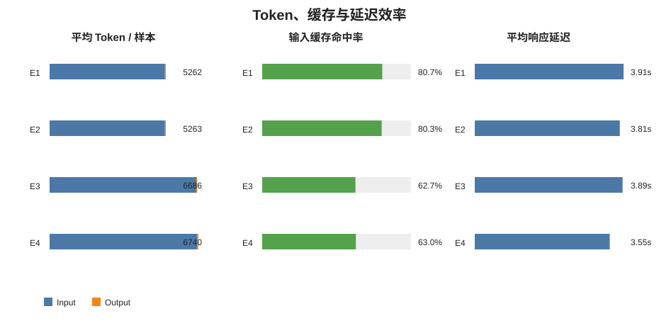

# GPT-5.6-sol 在 WikiSQL 上的现代 Text-to-SQL Baseline 实验报告
**实验日期：** 2026年11月18日  
**数据集：** WikiSQL  
**主模型：** GPT-5.6-sol  
**报告类型：** Test 集正式实验结果
## 摘要
本文评估 GPT-5.6-sol 在 WikiSQL Text-to-SQL 任务上的现代大语言模型基线。主系统 E4 结合动态 5-shot 检索、Schema-aware Reasoning Prompt 与 high reasoning effort，在完整 Test 集 15,878 条样本上取得 85.63% Logical Form Accuracy（LFA）和 90.77% Execution Accuracy（EX）。其 95% Wilson 置信区间分别为 [85.07%, 86.16%] 与 [90.31%, 91.21%]。全部预测均通过 JSON 与结构化 SQL 校验，SQL 执行成功率为 99.94%。在相同前 1,000 条 Test 子集上的成对消融表明，5-shot 检索带来稳定增益，而单独开启 high reasoning effort 未带来可观测改善。
## 1. 实验设置
### 1.1 数据与划分
Few-shot 示例仅从 Train 集动态检索；Dev 集用于 Prompt 调试与冻结；正式 API 推理仅覆盖 Test 集。E4 在完整 Test 集上运行，E1–E3 为节省成本各使用 Test 前 1,000 条。为保证消融公平性，本文另外报告 E4 在相同前 1,000 条上的结果。
### 1.2 对照组
| 实验 | Few-shot | Thinking | 推理强度 | Test 样本数 | 角色 |
|---|---:|---|---|---:|---|
| E1 | 0-shot | Off | none | 1,000 | 基础对照 |
| E2 | 0-shot | On | high | 1,000 | Thinking 消融 |
| E3 | 5-shot | Off | none | 1,000 | Few-shot 消融 |
| E4 | 5-shot | On | high | 15,878 | 主 Baseline |
### 1.3 Prompt、检索与 Token 优化
系统采用固定 Schema-aware developer 前缀，引导问题理解、字段匹配、聚合识别、条件识别和最终 JSON 校验。E3/E4 使用基于问题/表头词汇相似度、SQL 结构启发式及表头重合度的动态 5-shot 检索。目标表采用无损紧凑编码；Few-shot 示例保留 SQL 相关列的全部证据行。固定前缀通过稳定 cache key 使用 Prompt Caching。
### 1.4 评价标准
采用统一 WikiSQL 解析与 SQLite 执行器。LFA 比较选择列、聚合和无序 WHERE 条件；EX 比较预测 SQL 与金标 SQL 的执行结果。SQL Validity 表示结构校验通过，Execution Success Rate 表示结构有效预测中可成功执行的比例。Semantic Accuracy 预留给人工抽样，本报告未以自动指标替代人工评价。
## 2. 主实验结果
### 2.1 完整运行结果
| 实验 | N | LFA (%) | EX (%) | JSON Validity (%) | SQL Validity (%) | Execution Success (%) |
|---|---:|---:|---:|---:|---:|---:|
| E1 | 1,000 | 80.90 | 87.70 | 100.00 | 100.00 | 99.80 |
| E2 | 1,000 | 80.70 | 87.70 | 100.00 | 100.00 | 99.90 |
| E3 | 1,000 | 83.90 | 91.10 | 100.00 | 100.00 | 100.00 |
| E4 | 15,878 | 85.63 | 90.77 | 100.00 | 100.00 | 99.94 |

> 注：E1–E3 与 E4 的样本规模不同，本表用于汇总运行结果；严格消融结论应以表 2 的同一 1,000 条子集为准。
### 2.2 公平消融比较：相同前 1,000 条 Test
| 实验 | LFA (%) | EX (%) | 相对 E1：ΔLFA (pp) | 相对 E1：ΔEX (pp) |
|---|---:|---:|---:|---:|
| E1 | 80.90 | 87.70 | +0.00 | +0.00 |
| E2 | 80.70 | 87.70 | -0.20 | +0.00 |
| E3 | 83.90 | 91.10 | +3.00 | +3.40 |
| E4 | 83.70 | 90.80 | +2.80 | +3.10 |

### 2.3 成对显著性检验
采用同一样本上的双侧精确 McNemar 检验。

| 对比 | 指标 | 左组正确/右组错误 | 左组错误/右组正确 | p-value |
|---|---|---:|---:|---:|
| E1 vs E2 | LFA | 10 | 8 | 0.8145 |
| E1 vs E2 | EX | 8 | 8 | 1 |
| E1 vs E3 | LFA | 13 | 43 | 7.333e-05 |
| E1 vs E3 | EX | 12 | 46 | 8.22e-06 |
| E3 vs E4 | LFA | 10 | 8 | 0.8145 |
| E3 vs E4 | EX | 9 | 6 | 0.6072 |
## 3. 分层结果与错误分析
### 3.1 E4 按聚合类型分层
| 聚合 | N | LFA (%) | EX (%) |
|---|---:|---:|---:|
| NONE | 11,324 | 95.10 | 96.35 |
| MAX | 973 | 68.55 | 88.18 |
| MIN | 933 | 70.53 | 89.82 |
| COUNT | 1,455 | 59.18 | 68.25 |
| SUM | 587 | 44.12 | 59.63 |
| AVG | 606 | 63.04 | 76.40 |
### 3.2 E4 按 WHERE 条件数量分层
| 条件数量 | N | LFA (%) | EX (%) |
|---|---:|---:|---:|
| 0 | 131 | 91.60 | 93.13 |
| 1 | 10,832 | 87.68 | 92.79 |
| 2+ | 4,915 | 80.94 | 86.27 |
### 3.3 逻辑形式与执行结果差异
| 类型 | 数量 | 比例 (%) | 解释 |
|---|---:|---:|---|
| LF correct / EX correct | 13,596 | 85.63 | 逻辑形式与执行结果均正确 |
| LF wrong / EX correct | 817 | 5.15 | 非金标逻辑形式但在当前表上得到相同答案 |
| LF correct / EX wrong | 0 | 0.00 | 逻辑匹配但执行差异，应重点检查数值规范化/执行器边界 |
| LF wrong / EX wrong | 1,465 | 9.23 | 真实 Text-to-SQL 预测错误 |

E4 共出现 10 条不可执行预测；全部原因为条件操作符 `OP=3` 不在官方 SQLite 执行器支持的 `= / > / <` 范围内。
### 3.4 检索相似度与性能
| Top-1 检索分数四分位 | 分数范围 | N | LFA (%) | EX (%) |
|---|---|---:|---:|---:|
| Q1 | 0.239–0.671 | 3,969 | 83.04 | 89.42 |
| Q2 | 0.671–0.776 | 3,970 | 83.35 | 89.29 |
| Q3 | 0.776–0.859 | 3,969 | 86.80 | 91.91 |
| Q4 | 0.859–1.000 | 3,970 | 89.32 | 92.47 |
## 4. 效率、缓存与成本
| 实验 | 输入 Token/样本 | 输出 Token/样本 | 缓存命中率 (%) | 平均延迟 (s) | P95 (s) | 估算成本 (USD) |
|---|---:|---:|---:|---:|---:|---:|
| E1 | 5225.1 | 36.9 | 80.70 | 3.91 | 9.06 | 13.21 |
| E2 | 5225.1 | 38.2 | 80.28 | 3.81 | 5.98 | 13.27 |
| E3 | 6646.6 | 39.1 | 62.68 | 3.89 | 7.47 | 19.04 |
| E4 | 6693.7 | 46.7 | 62.96 | 3.55 | 5.99 | 306.14 |

四组实验程序估算总成本为 **$351.65**。该值依据实验程序中配置的单价及缓存折扣计算，仅用于实验内比较，不等同于服务商最终账单。
## 5. 结果讨论
1. **Few-shot 是主要增益来源。** 在同一 1,000 条子集上，E3 相比 E1 的 LFA 提升 3.00 个百分点，EX 提升 3.40 个百分点；成对检验用于判断该增益是否超出样本波动。动态检索示例帮助模型更稳定地识别聚合、选择列和 WHERE 条件。
2. **Thinking High 未表现出独立收益。** E2 与 E1 的 EX 完全相同，LFA 略低 0.20 个百分点；E4 相对 E3 的变化也不显著。API 请求确实记录了 `reasoning.effort=high`，但同一 1,000 条子集上报告的 reasoning tokens 为 E1=4,455、E2=5,738、E3=6,491、E4=5,762，并未随 Thinking 配置单调增加。因此该 usage 字段不宜被直接解释为模型内部推理强度，只能依据端到端正确率评估其效果。
3. **执行指标高于逻辑形式指标。** E4 的 EX 比 LFA 高 5.15 个百分点，说明部分非金标 SQL 在具体表上产生相同答案。这是 WikiSQL 中常见的 denotation equivalence，亦表明仅使用 EX 可能高估结构生成质量。
4. **结构化输出非常稳定。** 四组 JSON 与结构 SQL 有效率均为 100%，证明严格 JSON Schema、固定 Prompt 前缀和本地规范化能够有效避免格式错误。E4 仍有少量执行失败，主要应归因于结构合法但执行器不支持或数值解析边界。
5. **Prompt Caching 明显降低有效输入成本。** 各组均出现较高缓存命中率；Few-shot 增加输入长度，但固定前缀缓存抵消了部分成本。E4 的平均响应延迟仍维持在约 3.55 秒。
## 6. 有效性威胁与限制
- E1–E3 仅使用 Test 前 1,000 条，不是随机或分层抽样；它们可用于同一子集内的成对消融，但不应直接视为全 Test 总体估计。
- Semantic Accuracy 尚未完成正式人工双人标注与一致性检验，因此本报告不提供该指标。
- 估算成本依赖程序中配置的单价和缓存折扣，不代表实际账单。
- Thinking 模式由 API 参数定义；返回的 reasoning-token 计数与配置不呈单调关系，模型内部推理机制仍不可直接观测。
- WikiSQL 主要覆盖单表、有限聚合与简单条件，结果不能直接外推至 Spider 等复杂多表 Text-to-SQL 场景。
## 7. 结论
GPT-5.6-sol 的 E4 主 Baseline 在 WikiSQL 完整 Test 集上达到 **85.63% LFA** 与 **90.77% EX**，并保持 100% JSON/SQL 结构有效率。消融结果表明，动态 5-shot 检索是性能提升的主要来源，而在当前任务与接口条件下，单独开启 high reasoning effort 未产生稳定增益。该实验流程具备统一评价、Prompt 冻结、断点续跑、缓存统计和错误追踪能力，可作为后续检索方法、Prompt 策略和人工语义评价研究的可复现基线。
## 参考文献
[1] Zhong, V., Xiong, C., & Socher, R. (2017). *Seq2SQL: Generating Structured Queries from Natural Language using Reinforcement Learning*. arXiv:1709.00103.
[2] Salesforce Research. *WikiSQL: A Large Annotated Semantic Parsing Corpus for Developing Natural Language Interfaces*. Official repository and evaluation script.
